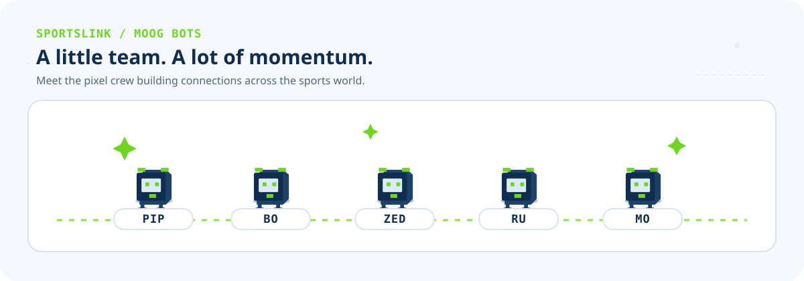
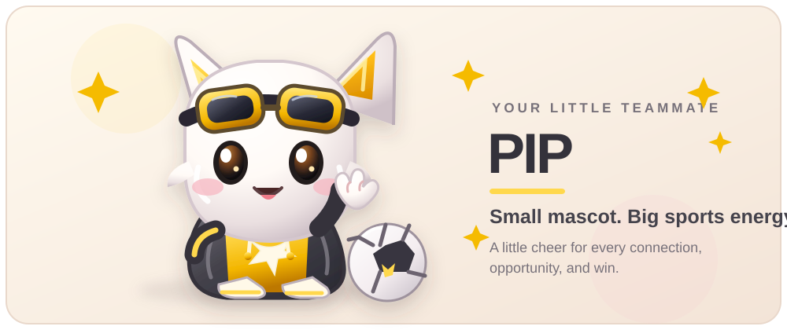
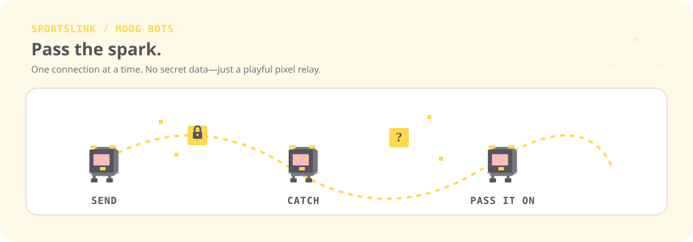
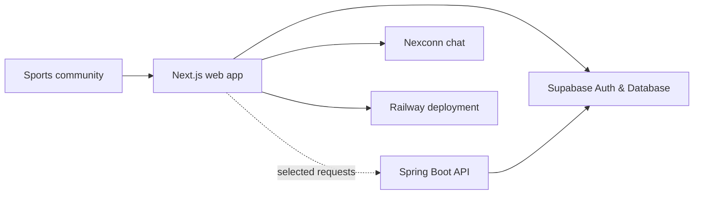

<div align="center">

<picture>
  
</picture>

# SPORTSLINK

### Connect. Discover. Grow. Move sport forward.

A professional networking platform for the sports community — bringing athletes, coaches, scouts, clubs, and sports professionals closer to people and opportunities.

<p>
  <a href="https://sportslink.up.railway.app/"></a>
  <a href="https://github.com/addulasaikiran-ops/SportsLink/issues"></a>
</p>



*Meet Pip — your tiny teammate for big sports energy.*

</div>

---

<picture></picture>

## ⚽ What is SPORTSLINK?

Sport is more than a game. It is people, teams, talent, relationships, and opportunities.

SPORTSLINK helps the sports community build a professional presence, discover people, share updates, connect with others, and explore opportunities in one place.

## ✨ Features

<picture></picture>

- **Profiles** — showcase your sporting role, experience, skills, and journey.
- **Discover people** — find athletes, coaches, scouts, and other sports professionals.
- **Community feed** — share updates and interact through comments and reactions.
- **Connections and follows** — grow your professional sports network.
- **Opportunities** — explore sporting roles, trials, scholarships, sponsorships, and more.
- **Messaging and notifications** — stay connected with your community.
- **Organizations and events** — discover and participate in the wider sports ecosystem.

*Note: Feature availability and completion can vary. See the [implementation audit](docs/FACTS.md) for repository-backed details.*

## 🛠️ Tech stack

<picture></picture>

| Area | Technology |
|---|---|
| Web application | Next.js, React, TypeScript |
| Authentication and database | Supabase |
| Backend API | Spring Boot, Java |
| Chat | Nexconn integration |
| Motion and UI | GSAP, Lucide React |
| Android workflow | Capacitor and GitHub Actions |
| Deployment | Railway |

## 🧭 Architecture



The frontend uses Supabase for authentication and data access, with a Spring Boot API supporting selected workflows. Not every frontend feature goes through the Spring API.

## 🚀 Run locally

### Frontend

Requirements: Node.js (CI uses Node 22).

```bash
cd Frontend/sportslink-frontend-js
cp .env.local.example .env.local
npm install
npm run dev
```

Open http://localhost:3000. Add the required Supabase and other feature-specific values to `.env.local`; never commit secrets.

### Backend

Requirements: Java 25.

```bash
cd Backend/sportslink-backend
./gradlew test
./gradlew bootRun
```

On Windows, use `./gradlew.bat test` and `./gradlew.bat bootRun`.

## 📁 Project structure

```text
SportsLink/
├── .github/workflows/          # CI and build workflows
├── Backend/
│   └── sportslink-backend/     # Spring Boot API
├── Frontend/
│   └── sportslink-frontend-js/ # Next.js application
├── supabase/migrations/        # Database migrations
└── docs/
    ├── FACTS.md                # Implementation audit
    └── assets/                 # README animations and mascot artwork
```

## 🤝 Contributing

Ideas, bug reports, and contributions are welcome!

1. Check the existing [issues](https://github.com/addulasaikiran-ops/SportsLink/issues).
2. Describe the change or bug clearly.
3. Keep pull requests focused and include test details.
4. Never commit credentials, tokens, or private user data.

## 📌 Project notes

- The Android workflow currently builds a **debug APK**; it is not a Play Store release pipeline.
- Some features use direct Supabase access while others use the Spring Boot API.
- Read [docs/FACTS.md](docs/FACTS.md) for the detailed implementation audit, known limitations, and supporting evidence.

---

<div align="center">

<picture></picture>

**Built for the people who move sport forward.** 💛

[Open SPORTSLINK](https://sportslink.up.railway.app/) · [Report an issue](https://github.com/addulasaikiran-ops/SportsLink/issues)

</div>
