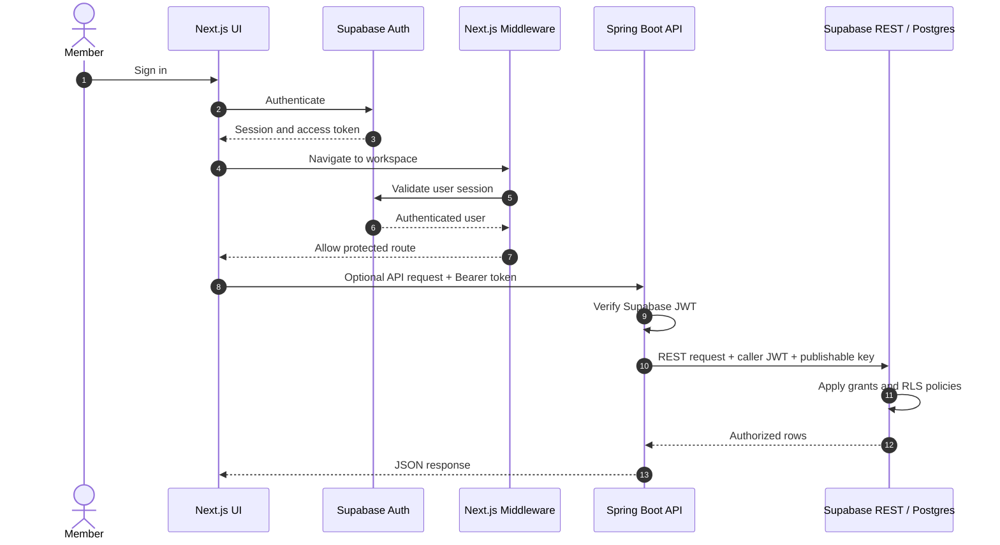
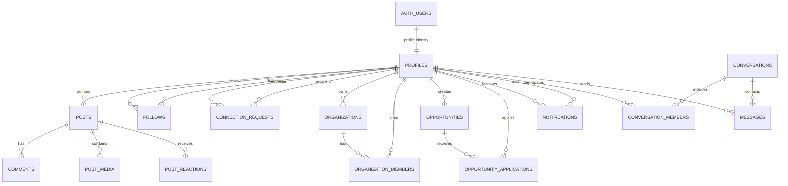

<div align="center">

<picture>
  <source media="(prefers-color-scheme: dark)" srcset="docs/assets/hero-block-world-dark.svg">
  
</picture>

<p>
  
</p>

<p>
  <a href="https://sportslink.up.railway.app/"></a>
  
  
  
</p>

**The professional network for sport.**

Athletes, coaches, scouts, clubs and sports professionals — one connected community for meaningful relationships and opportunities.

[Explore SPORTSLINK](https://sportslink.up.railway.app/) · [Report an issue](https://github.com/addulasaikiran-ops/SportsLink/issues) · [Read the audit](docs/FACTS.md)

</div>

---

## The game is bigger when we're connected.

Sport moves forward through people: the athlete looking for a next step, the coach building a team, the scout finding talent, and the organization creating opportunity.

SPORTSLINK is a professional networking product built around those connections. Discover profiles, grow your network, share updates, exchange messages and explore sports opportunities.

<picture>
  <source media="(prefers-color-scheme: dark)" srcset="docs/assets/section-divider-dark.svg">
  
</picture>


<picture>
  <source media="(prefers-color-scheme: dark)" srcset="docs/assets/architecture-block-world-dark.svg">
  
</picture>

## Meet the SPORTSLINK crew

A little pixel-built personality for the people who move sport forward. These animated mascots are decorative README artwork—not claims about shipped product features.

<table>
<tr>
<td width="50%" align="center"><picture><source media="(prefers-color-scheme: dark)" srcset="docs/assets/creature-connector-dark.svg"></picture><strong>The Connector</strong><br>Bringing people into the same team.</td>
<td width="50%" align="center"><picture><source media="(prefers-color-scheme: dark)" srcset="docs/assets/creature-scout-dark.svg"></picture><strong>The Scout</strong><br>Always looking for the next opportunity.</td>
</tr>
<tr>
<td width="50%" align="center"><picture><source media="(prefers-color-scheme: dark)" srcset="docs/assets/creature-messenger-dark.svg"></picture><strong>The Messenger</strong><br>Keeping the conversation moving.</td>
<td width="50%" align="center"><picture><source media="(prefers-color-scheme: dark)" srcset="docs/assets/creature-builder-crew-dark.svg"></picture><strong>The Builder Crew</strong><br>Helping a community take shape.</td>
</tr>
</table>

<picture>
  <source media="(prefers-color-scheme: dark)" srcset="docs/assets/divider-coach-stroll-dark.svg">
  
</picture>

## The product, in motion

<picture>
  <source media="(prefers-color-scheme: dark)" srcset="docs/assets/stats-dark.svg">
  
</picture>

<sub>Counts are repository facts from the audited Git tree, not user or production usage metrics. See <a href="docs/FACTS.md">the evidence log</a>.</sub>

## Built around the people of sport

<table>
<tr>
<td width="50%">

**Discover your network**

Explore athlete, coach, scout and sports-professional profiles. Search profiles and send or respond to connection requests.
</td>
<td width="50%">

**Make your profile count**

Add your sporting role, sport, headline, bio, location, education, skills and profile imagery.
</td>
</tr>
<tr>
<td width="50%">

**Share the journey**

Publish posts, interact through comments and reactions, bookmark useful updates and repost community content.
</td>
<td width="50%">

**Find the next opportunity**

Explore sports roles, trials, scholarships, teams, sponsorships, volunteer work and other opportunities.
</td>
</tr>
<tr>
<td width="50%">

**Keep conversations moving**

Use member messaging, conversation threads and notifications to stay in touch.
</td>
<td width="50%">

**Bring organizations together**

Create sports organizations, request membership and review member requests.
</td>
</tr>
</table>

<sub>Feature descriptions reflect repository UI/API code and migrations. Individual screens may use direct Supabase access, the optional Spring API, or the Nexconn chat integration; not every feature is routed through one backend. Details and wiring status are in <a href="docs/FACTS.md">FACTS.md</a>.</sub>

<picture>
  <source media="(prefers-color-scheme: dark)" srcset="docs/assets/section-divider-dark.svg">
  
</picture>

## How SPORTSLINK is put together

<picture>
  <source media="(prefers-color-scheme: dark)" srcset="docs/assets/architecture-dark.svg">
  
</picture>

The browser-facing product is a Next.js App Router application. It uses Supabase Auth and data access, with a Spring Boot REST API available for selected flows. The backend validates Supabase JWTs and forwards the caller's token to Supabase REST so database grants and row-level security remain in force. The frontend also includes a Nexconn chat client and a server-side token route.

### Authentication and request flow



*Direct-Supabase screens can call Supabase from the browser instead of traversing the Spring Boot API. The diagram shows the optional API path.*

## Technology stack

<div align="center">
<picture>
  <source media="(prefers-color-scheme: dark)" srcset="docs/assets/tech-marquee-dark.svg">
  
</picture>
</div>

| Layer | Technology | Verified version / detail |
|---|---|---|
| Web framework | Next.js | Lockfile 15.5.27 |
| UI | React / React DOM | Lockfile 19.3.0 |
| Auth and database client | Supabase JS + SSR | 2.117.1 / 0.12.7 |
| API | Spring Boot Web MVC + Security | Plugin 4.1.1 |
| Runtime | Java | Toolchain 25 |
| Build | Gradle | Wrapper 9.7.1 |
| Motion | GSAP | 3.15.0 |
| Icons | Lucide React | 0.468.0 |
| Chat integration | Nexconn packages | Chat 26.2.1; Chat UI 26.2.5; Engine 26.2.1 |
| Native wrapper workflow | Capacitor | CI installs Capacitor 7 tooling for APK build |

<picture>
  <source media="(prefers-color-scheme: dark)" srcset="docs/assets/section-divider-dark.svg">
  
</picture>

## API surface

The Spring Boot backend defines 29 REST operations. All require a valid Supabase access token except the public health endpoint. The frontend's Spring API path is optional and controlled by **NEXT_PUBLIC_USE_SPRING_API** (sample default: **false**).

<details>
<summary><strong>View all Spring Boot endpoints</strong></summary>

| Method | Endpoint | Auth |
|---|---|---:|
| GET | /api/health | No |
| GET | /api/me | Yes |
| GET | /api/profiles | Yes |
| GET | /api/profiles/me | Yes |
| PATCH | /api/profiles/me | Yes |
| GET | /api/posts | Yes |
| POST | /api/posts | Yes |
| GET | /api/posts/{postId}/comments | Yes |
| POST | /api/posts/{postId}/comments | Yes |
| GET | /api/posts/{postId}/reactions | Yes |
| PUT | /api/posts/{postId}/reaction | Yes |
| DELETE | /api/posts/{postId}/reaction | Yes |
| GET | /api/follows | Yes |
| POST | /api/follows/{profileId} | Yes |
| DELETE | /api/follows/{profileId} | Yes |
| GET | /api/notifications | Yes |
| PATCH | /api/notifications/{notificationId}/read | Yes |
| DELETE | /api/notifications/{notificationId} | Yes |
| GET | /api/opportunities | Yes |
| POST | /api/opportunities | Yes |
| GET | /api/applications/me | Yes |
| GET | /api/opportunities/{opportunityId}/applications | Yes |
| POST | /api/opportunities/{opportunityId}/applications | Yes |
| PATCH | /api/applications/{applicationId}/status | Yes |
| GET | /api/conversations | Yes |
| POST | /api/conversations | Yes |
| GET | /api/conversations/{conversationId}/messages | Yes |
| POST | /api/conversations/{conversationId}/messages | Yes |
| PATCH | /api/conversations/{conversationId}/read | Yes |

</details>

## Data layer

The repository contains 14 SQL migration files across two locations: the root **supabase/migrations/** directory and the frontend's **Frontend/sportslink-frontend-js/supabase/migrations/** directory.

### Entity relationship overview

This ER diagram covers entities explicitly related in the audited migration and service code. It is a selected relationship view, not a generated dump of the full live database schema.



### Migration ledger

For migration-by-migration purpose, indexes, policies and duplicate migration analysis, see [the full database audit](docs/FACTS.md#database-migrations-filename-order).

**Connection requests are implemented and used.** The directory and public member profile components read and write **connection_requests**; it is not an unused table. See [the explicit evidence](docs/FACTS.md#connection_requests--explicitly-wired).

## Security posture — what the code actually configures

- Supabase JWT resource-server validation in Spring Security.
- Public exception limited to **GET /api/health** (OPTIONS preflight requests are also permitted).
- Configurable CORS origin allowlist; credentials are not enabled.
- Request DTO validation via Jakarta Validation.
- Spring REST proxy forwards the authenticated member's token and the Supabase publishable key; no service-role key is used in the request path described by the code.
- Supabase RLS policies and Storage object policies are defined in the audited migrations.
- Next.js middleware checks the Supabase session and gates workspace routes.
- Nexconn app secret is server-only in the token route.

**Not claimed:** repository evidence inspected here does not establish backend rate limiting or custom CSP/security-header configuration. See [security evidence and limitations](docs/FACTS.md#security-and-request-handling).

## Run locally

### Frontend

Requirements: Node.js (CI uses Node 22).

```bash
cd Frontend/sportslink-frontend-js
cp .env.local.example .env.local
npm install
npm run dev
```

The app's local development URL is http://localhost:3000.

### Backend

Requirements: Java 25.

```bash
cd Backend/sportslink-backend
./gradlew test
./gradlew bootRun
```

On Windows PowerShell use ./gradlew.bat test and ./gradlew.bat bootRun.

### Environment variables

Set only the values required by features you enable. Names below come from checked-in example/config files; never commit actual secrets.

| Variable | Used by |
|---|---|
| NEXT_PUBLIC_SUPABASE_URL | Frontend Supabase clients |
| NEXT_PUBLIC_SUPABASE_PUBLISHABLE_KEY | Frontend Supabase clients |
| NEXT_PUBLIC_API_URL | Frontend Spring API adapter |
| NEXT_PUBLIC_USE_SPRING_API | Optional Spring integration switch |
| NEXT_PUBLIC_NEXCONN_APP_KEY | Nexconn app identity |
| NEXCONN_APP_SECRET | Server-side Nexconn token signing |
| NEXCONN_API_BASE_URL | Nexconn regional API |
| SUPABASE_URL | Backend Supabase REST base URL |
| SUPABASE_PUBLISHABLE_KEY | Backend Supabase REST API key |
| SUPABASE_JWT_ISSUER | Optional JWT issuer override |
| SUPABASE_JWKS_URL | Optional JWKS URL override |
| SPORTSLINK_CORS_ALLOWED_ORIGIN | Backend CORS origin allowlist |
| NEXT_PUBLIC_SITE_URL | Canonical site and auth callback origin |

The demo seed workflow also expects Actions secrets named **SUPABASE_URL** and **SUPABASE_SERVICE_ROLE_KEY**. They are used by the manual seed workflow; do not expose them to frontend/browser code.

## Project map

```text
SportsLink/
├── .github/
│   └── workflows/
├── Backend/
│   └── sportslink-backend/
│       ├── src/main/java/com/sportslink/sportslink_backend/
│       ├── src/main/resources/
│       └── src/test/
├── Frontend/
│   └── sportslink-frontend-js/
│       ├── app/
│       ├── components/
│       ├── design-system/
│       ├── lib/
│       ├── public/
│       ├── scripts/seed/
│       └── supabase/migrations/
├── supabase/
│   └── migrations/
├── docs/
│   ├── FACTS.md
│   └── assets/
└── README.md
```

## CI and delivery

Four workflows are present:
- Backend CI builds and tests the Spring Boot service on Java 25.
- Frontend CI validates the npm lockfile and builds the Next.js application on Node 22.
- Android workflow builds and uploads a debug APK on manual dispatch.
- Demo seed workflow is manual, environment-gated and requires an explicit confirmation input.

The Android workflow demonstrates a debug APK artifact workflow; it does not establish a Play Store release pipeline.

## Roadmap / current boundaries

Repository gaps are listed as implementation boundaries, not promises or implied features:
- The Spring API integration switch is off by default in the sample frontend environment; callers use direct Supabase for several operations unless enabled.
- There is no frontend test/spec suite in the tracked tree; frontend CI performs a production build.
- Backend tests mock the Supabase REST client; no live-database integration test is shown in the tracked test source.
- Root and frontend migration folders coexist and include overlapping connection-request schema creation; migration history should be consolidated deliberately before new environments depend on a single migration command.
- Rate limiting and custom backend security-header/CSP configuration were not found in the audited files.
- Some frontend pages still present empty/unavailable workspaces while API operations or schema structures exist.

For precise evidence and per-feature wired status, use [docs/FACTS.md](docs/FACTS.md).

<picture>
  <source media="(prefers-color-scheme: dark)" srcset="docs/assets/footer-dark.svg">
  
</picture>

<div align="center">

**Built for the people who move sport forward.**

[SPORTSLINK](https://sportslink.up.railway.app/) · [GitHub](https://github.com/addulasaikiran-ops/SportsLink)

</div>
