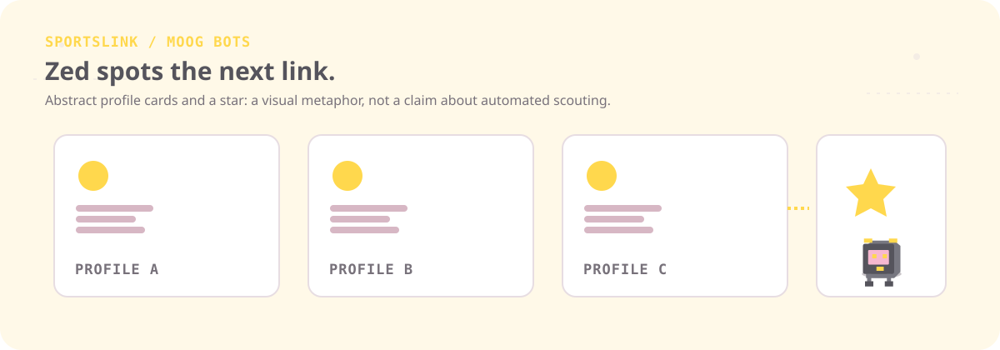
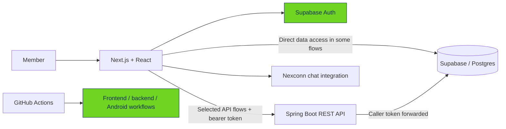
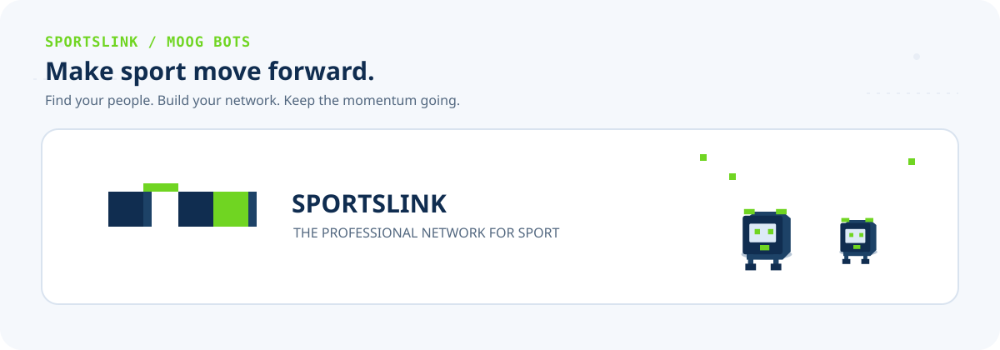

<div align="center">

<picture>
  
</picture>

<h1>SPORTSLINK</h1>

<p><strong>The professional network for sport.</strong><br>Find your people. Build your network. Move sport forward.</p>

<p>
  <a href="https://sportslink.up.railway.app/"></a>
  <a href="https://github.com/addulasaikiran-ops/SportsLink"></a>
  <a href="docs/FACTS.md"></a>
</p>

<p><a href="#the-moog-bots">Meet the bots</a> · <a href="#what-you-can-do">Explore the platform</a> · <a href="#under-the-hood">Architecture</a> · <a href="#run-locally">Run locally</a></p>

</div>

<picture></picture>

## The idea

Sport runs on people: athletes finding coaches, scouts spotting potential, clubs building teams, and professionals sharing opportunities. **SPORTSLINK is a professional networking platform focused on the sports community**—a place to discover people, build connections, share updates, and explore sporting opportunities.

The Moog Bots are the little pixel crew that brings this README to life. They jump, pass a glowing block, scout profile cards, and help move the build along. Their scenes are decorative illustrations, not representations of live user activity or product automation.

## The Moog Bots

<table width="100%">
<tr>
<td width="20%" align="center"><strong>01 · PIP</strong><br><sub>Messenger</sub><br><sub>Gets the conversation moving.</sub></td>
<td width="20%" align="center"><strong>02 · BO</strong><br><sub>Connector</sub><br><sub>Links people and teams.</sub></td>
<td width="20%" align="center"><strong>03 · ZED</strong><br><sub>Scout</sub><br><sub>Looks for the next connection.</sub></td>
<td width="20%" align="center"><strong>04 · RU</strong><br><sub>Builder</sub><br><sub>Keeps the pieces moving.</sub></td>
<td width="20%" align="center"><strong>05 · MO</strong><br><sub>Mascot</sub><br><sub>Always hops in first.</sub></td>
</tr>
</table>

**Tiny lore:** the lime block is a mystery parcel in a cartoon relay. Pip crouches, Bo makes a catch, Zed checks the route, Ru steadies the next step, and Mo celebrates before anyone else. The dots and question marks are visual jokes—not actual messages, credentials, encryption, or a security feature.

<picture></picture>

## What you can do

<table width="100%">
<tr>
<td width="50%" valign="top">

### Discover people
Explore profiles across the sports community and find athletes, coaches, scouts, and sports professionals.

### Build your profile
Present your role, sporting interests, headline, biography, and profile details.

### Grow your network
Send, review, accept, or decline connection requests. The repository includes a `connection_requests` data model and frontend flows that use it.

</td>
<td width="50%" valign="top">

### Share community updates
The platform includes a feed experience with posts and interaction surfaces.

### Explore opportunities
Find sports-related opportunities and review the relevant application flows.

### Organizations and messaging
The codebase includes organization-related screens and membership flows, plus a Nexconn chat integration. The exact level of backend wiring differs by feature; this README does not imply every screen uses the same API path.

</td>
</tr>
</table>

> **Implementation note:** feature descriptions are based on the repository, not a guarantee that every flow is fully enabled in the deployed app. Some screens access Supabase directly; selected flows can use the Spring API; chat has a Nexconn integration. See [the repository audit](docs/FACTS.md) for evidence and wiring caveats.

## Project snapshot

The counts below describe the audited Git tree—not live traffic, user totals, or production health.

| Repository measure | Verified count |
|---|---:|
| Tracked files | 189 |
| Frontend files | 129 |
| Backend files | 42 |
| GitHub Actions workflow files | 4 |
| Next.js App Router page modules | 13 |
| Concrete page paths when allowed dynamic sections are expanded | 22 |
| Backend REST operations | 29 |
| SQL migration files across both migration directories | 14 |

The page-path count is not a count of page modules, and the migration files are not a complete bootstrap schema. The audit documents the counting method and limitations.

## Under the hood

<picture></picture>

SPORTSLINK is a multi-part application. The main pieces found in the repository are:

| Layer | Technology | Repository evidence |
|---|---|---|
| Web app | Next.js App Router, React, JavaScript / JSX | Frontend package manifest and app routes |
| Auth and data | Supabase Auth, Supabase JS / SSR, Postgres and RLS policies in migrations | Frontend dependencies, data-access code, SQL migrations |
| REST API | Spring Boot Web MVC and Spring Security | Backend Gradle build and Java controllers |
| Runtime | Java toolchain 25 | Backend build configuration |
| Build | Gradle wrapper 9.7.1 | Wrapper properties |
| Motion and icons | GSAP, Lucide React | Frontend dependencies |
| Chat integration | Nexconn packages and token route | Frontend dependencies and Next.js route handler |
| CI workflows | GitHub Actions | `.github/workflows/` |

### A simplified request path



Some frontend features use Supabase directly rather than passing through Spring Boot. The Spring API defines 29 operations, but the repository audit does **not** claim all 29 are exercised by frontend callers. Security behavior, RLS, and route-level wiring should be checked against the code and migrations before drawing conclusions about any individual flow.

<details>
<summary><strong>Spring Boot REST endpoints (expand)</strong></summary>

| Method | Endpoint | Authentication |
|---|---|---|
| GET | `/api/health` | Public |
| GET | `/api/me` | Required |
| GET | `/api/profiles` | Required |
| GET | `/api/profiles/me` | Required |
| PATCH | `/api/profiles/me` | Required |
| GET | `/api/posts` | Required |
| POST | `/api/posts` | Required |
| GET | `/api/posts/{postId}/comments` | Required |
| POST | `/api/posts/{postId}/comments` | Required |
| GET | `/api/posts/{postId}/reactions` | Required |
| PUT | `/api/posts/{postId}/reaction` | Required |
| DELETE | `/api/posts/{postId}/reaction` | Required |
| GET | `/api/follows` | Required |
| POST | `/api/follows/{profileId}` | Required |
| DELETE | `/api/follows/{profileId}` | Required |
| GET | `/api/notifications` | Required |
| PATCH | `/api/notifications/{notificationId}/read` | Required |
| DELETE | `/api/notifications/{notificationId}` | Required |
| GET | `/api/opportunities` | Required |
| POST | `/api/opportunities` | Required |
| GET | `/api/applications/me` | Required |
| GET | `/api/opportunities/{opportunityId}/applications` | Required |
| POST | `/api/opportunities/{opportunityId}/applications` | Required |
| PATCH | `/api/applications/{applicationId}/status` | Required |
| GET | `/api/conversations` | Required |
| POST | `/api/conversations` | Required |
| GET | `/api/conversations/{conversationId}/messages` | Required |
| POST | `/api/conversations/{conversationId}/messages` | Required |
| PATCH | `/api/conversations/{conversationId}/read` | Required |

</details>

### Data and security notes

- Supabase access appears both directly in frontend code and through the Spring API.
- The backend validates Supabase JWTs and forwards the caller's token to Supabase REST for its request path; this is not the same as every frontend action going through Spring.
- SQL migrations define RLS and storage policies for the objects they touch, but the repository does not include a single baseline migration that bootstraps every table listed in application code.
- The repository contains `connection_requests` references in both the frontend flows and SQL migrations. It is **not** an unused table.
- No rate-limiting implementation was found in the inspected backend security/controllers. Do not assume one exists without further verification.

For full route inventory, migration details, auth notes, counting methodology, and file-level evidence, open [docs/FACTS.md](docs/FACTS.md).

## Workflows, with a little hop

The build illustration is a metaphor, not a live CI dashboard. The repository currently contains four workflow files; inspect [`.github/workflows/`](.github/workflows/) for the actual triggers and commands. The workflow set includes frontend/backend checks and Android/demo-related automation. A green pixel in the illustration is not evidence that a workflow has passed.

## Run locally

### 1. Requirements

- Node.js compatible with the repository's frontend workflow (Node 22 is used in frontend CI).
- Java 25 for the backend.
- Git.
- Supabase project configuration for features that need authentication or database access.

### 2. Frontend

```bash
cd Frontend/sportslink-frontend-js
npm ci
```

Create a local `.env.local` from the repository's `.env.local.example` and fill in the values for your own development environment. Never commit real secrets.

```bash
npm run dev
```

Open [http://localhost:3000](http://localhost:3000).

### 3. Backend (optional)

In a second terminal:

```bash
cd Backend/sportslink-backend
./gradlew bootRun
```

On Windows, use `gradlew.bat bootRun`. Configure the backend environment variables described by the backend configuration and deployment workflow. The frontend's `NEXT_PUBLIC_USE_SPRING_API` setting defaults to `false` in the example environment file, so do not assume the frontend uses the API unless configured to do so.

### 4. Build checks

Run the scripts defined by the project manifests and workflows. Use the repository's current CI configuration as the source of truth for required checks; a successful local frontend build alone does not validate the backend, Android packaging, database policies, or deployed service.

## Roadmap for contributors

Good next steps are to keep the README's feature claims aligned with actual frontend callers, document which screens use direct Supabase versus Spring endpoints, add repeatable frontend tests, and maintain a clear baseline for database setup. These are suggestions—not claims that the work is already implemented.

## Repository map

```text
SportsLink/
├── Frontend/sportslink-frontend-js/  # Next.js application
├── Backend/sportslink-backend/       # Spring Boot REST API
├── supabase/migrations/              # Root migration directory
├── .github/workflows/                # CI and automation
├── docs/
│   ├── FACTS.md                      # Evidence-based repository audit
│   └── assets/                       # README illustrations
└── README.md
```

## A final hop

<picture></picture>

<div align="center">

<strong>Find your people. Build your network. Move sport forward.</strong>

<br><br>

<a href="https://sportslink.up.railway.app/"></a>

<sub>Built for the people who move sport forward. Moog Bots artwork is decorative and uses inline SVG animation with reduced-motion fallbacks.</sub>

</div>
