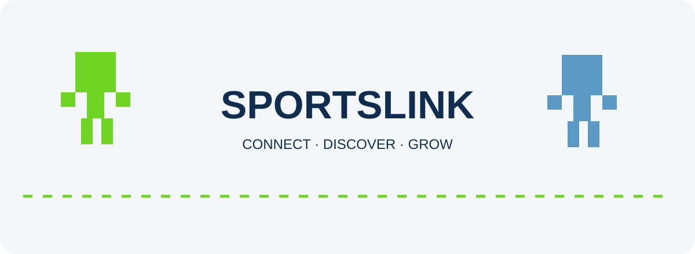
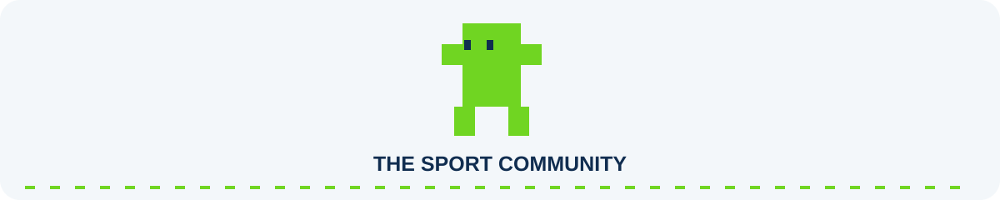
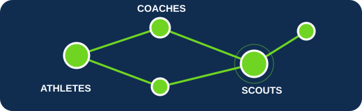
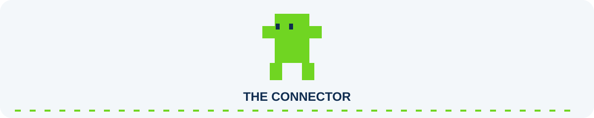
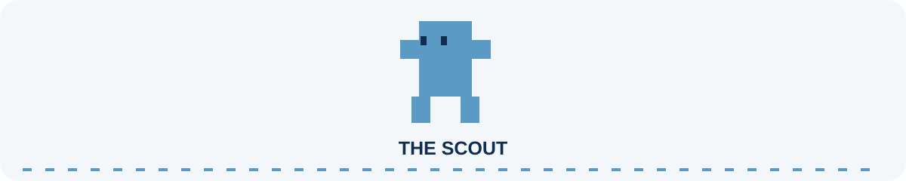
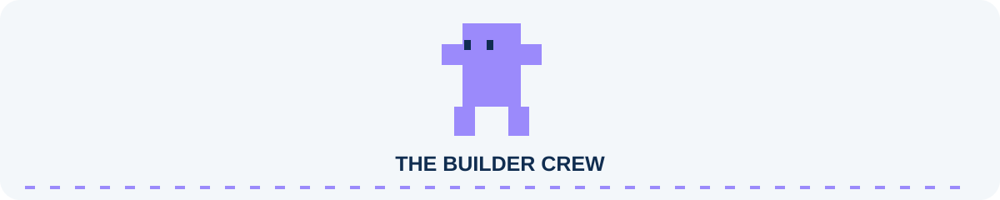
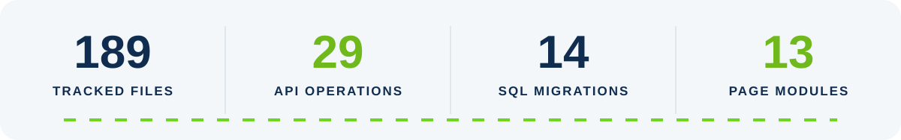
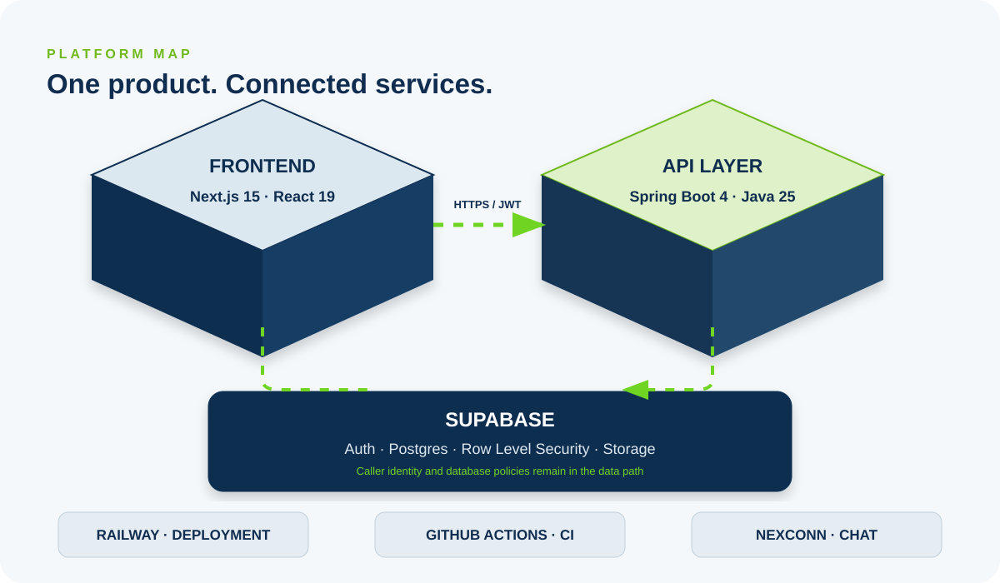
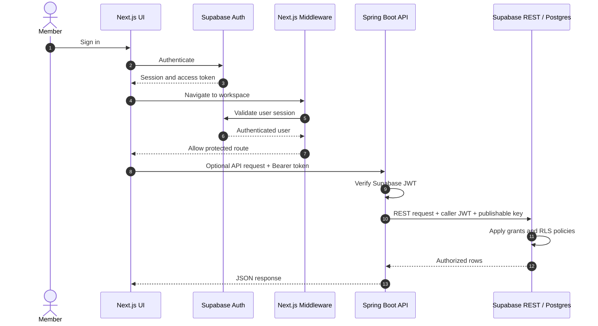
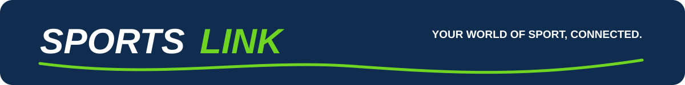

<div align="center">

<picture>
  <source media="(prefers-color-scheme: dark)" srcset="docs/assets/hero-block-world-dark.svg">
  
</picture>

<picture>
  <source media="(prefers-color-scheme: dark)" srcset="docs/assets/typing-tagline-dark.svg">
  
</picture>

<h3>
  <samp>BUILDING THE PROFESSIONAL NETWORK FOR SPORT</samp>
</h3>

<p><strong>A connected community for athletes, coaches, scouts, clubs and sports professionals.</strong></p>

<p>
  <a href="https://sportslink.up.railway.app/"></a>
  <a href="https://github.com/addulasaikiran-ops/SportsLink"></a>
  <a href="docs/FACTS.md"></a>
</p>

<p>
  <a href="#the-sportslink-world"><strong>Explore the platform</strong></a>
  &nbsp;·&nbsp;
  <a href="#technology-stack"><strong>Technology</strong></a>
  &nbsp;·&nbsp;
  <a href="#architecture"><strong>Architecture</strong></a>
  &nbsp;·&nbsp;
  <a href="#run-locally"><strong>Run locally</strong></a>
</p>

</div>

<picture>
  <source media="(prefers-color-scheme: dark)" srcset="docs/assets/divider-coach-stroll-dark.svg">
  
</picture>

## The SPORTSLINK world

Sport is more than a game. It is people, teams, talent, relationships and opportunities.

SPORTSLINK is a professional networking platform focused on the sports community. It brings athletes, coaches, scouts, clubs and other sports professionals into one connected place to discover people, build meaningful connections, share updates and explore opportunities.

<p align="center">
  <a href="https://sportslink.up.railway.app/">
    
  </a>
</p>

## Your starting points

<table align="center" width="100%">
<tr>
<td align="center" width="50%">
<a href="https://sportslink.up.railway.app/"></a>
<strong><a href="https://sportslink.up.railway.app/">ENTER SPORTSLINK</a></strong><br>
<sub>Explore the live platform and connect with the sports community.</sub>
</td>
<td align="center" width="50%">
<a href="docs/FACTS.md"></a>
<strong><a href="docs/FACTS.md">PROJECT FACTS</a></strong><br>
<sub>Review verified repository details, implementation status and technical evidence.</sub>
</td>
</tr>
<tr>
<td align="center" width="50%">
<a href="#technology-stack"></a>
<strong><a href="#technology-stack">TECH STACK</a></strong><br>
<sub>See the tools and frameworks powering SPORTSLINK.</sub>
</td>
<td align="center" width="50%">
<a href="#run-locally"></a>
<strong><a href="#run-locally">DEVELOPER SETUP</a></strong><br>
<sub>Set up the frontend and backend on your machine.</sub>
</td>
</tr>
</table>

<picture>
  <source media="(prefers-color-scheme: dark)" srcset="docs/assets/divider-coach-stroll-dark.svg">
  
</picture>

## Meet the SPORTSLINK crew

Our small pixel crew represents the connections that make the sports world move. These characters are decorative project artwork.

<table align="center" width="100%">
<tr>
<td width="50%" align="center">
<picture><source media="(prefers-color-scheme: dark)" srcset="docs/assets/creature-connector-dark.svg"></picture>
<strong>THE CONNECTOR</strong><br><sub>Bringing the sports community together.</sub>
</td>
<td width="50%" align="center">
<picture><source media="(prefers-color-scheme: dark)" srcset="docs/assets/creature-scout-dark.svg"></picture>
<strong>THE SCOUT</strong><br><sub>Spotting talent and new possibilities.</sub>
</td>
</tr>
<tr>
<td width="50%" align="center">
<picture><source media="(prefers-color-scheme: dark)" srcset="docs/assets/creature-messenger-dark.svg"></picture>
<strong>THE MESSENGER</strong><br><sub>Keeping conversations moving.</sub>
</td>
<td width="50%" align="center">
<picture><source media="(prefers-color-scheme: dark)" srcset="docs/assets/creature-builder-crew-dark.svg"></picture>
<strong>THE BUILDER CREW</strong><br><sub>Growing teams and organizations.</sub>
</td>
</tr>
</table>

<picture>
  <source media="(prefers-color-scheme: dark)" srcset="docs/assets/divider-coach-stroll-dark.svg">
  
</picture>

## The platform

<table width="100%">
<tr>
<td width="50%" valign="top">

### Discover your network
Explore athlete, coach, scout and sports-professional profiles. Search for people and send or respond to connection requests.
</td>
<td width="50%" valign="top">

### Build your profile
Showcase your sporting role, sport, headline, bio, location, education, skills and profile imagery.
</td>
</tr>
<tr>
<td width="50%" valign="top">

### Share updates
Publish posts, comment, react, bookmark useful updates and repost community content.
</td>
<td width="50%" valign="top">

### Explore opportunities
Discover sports roles, trials, scholarships, teams, sponsorships, volunteer work and other opportunities.
</td>
</tr>
<tr>
<td width="50%" valign="top">

### Stay connected
Use member messaging, conversation threads and notifications to keep in touch.
</td>
<td width="50%" valign="top">

### Connect organizations
Create sports organizations, request membership and review member requests.
</td>
</tr>
</table>

<sub>Feature descriptions reflect repository UI/API code and migrations. Some features use direct Supabase access, the optional Spring API or Nexconn chat integration; not every feature is routed through one backend. See <a href="docs/FACTS.md">the implementation audit</a> for details.</sub>

## Project snapshot

<picture>
  <source media="(prefers-color-scheme: dark)" srcset="docs/assets/stats-dark.svg">
  
</picture>

<sub>Repository counts from the audited Git tree, not live user or production usage metrics. Evidence: <a href="docs/FACTS.md">docs/FACTS.md</a>.</sub>

<picture>
  <source media="(prefers-color-scheme: dark)" srcset="docs/assets/divider-coach-stroll-dark.svg">
  
</picture>

## Technology stack

<div align="center">
<picture>
  <source media="(prefers-color-scheme: dark)" srcset="docs/assets/tech-marquee-dark.svg">
  
</picture>
</div>

| Layer | Technology | Verified version / detail |
|---|---|---|
| Web framework | Next.js | 15.5.27 |
| UI | React / React DOM | 19.3.0 |
| Auth and database | Supabase JS + SSR | 2.117.1 / 0.12.7 |
| API | Spring Boot Web MVC + Security | 4.1.1 |
| Runtime | Java | Toolchain 25 |
| Build | Gradle | Wrapper 9.7.1 |
| Motion | GSAP | 3.15.0 |
| Icons | Lucide React | 0.468.0 |
| Chat integration | Nexconn | Chat 26.2.1; UI 26.2.5; Engine 26.2.1 |
| Android workflow | Capacitor | CI builds a debug APK |

## Architecture

<picture>
  <source media="(prefers-color-scheme: dark)" srcset="docs/assets/architecture-dark.svg">
  
</picture>

SPORTSLINK is built around a Next.js App Router frontend. It uses Supabase Auth and data access, with a Spring Boot REST API available for selected flows. The backend validates Supabase JWTs and forwards the caller's token to Supabase REST so database grants and row-level security remain in force. The frontend also includes a Nexconn chat client and a server-side token route.

### Authentication and request flow



<sub>Some frontend screens call Supabase directly rather than traversing Spring Boot. The sequence shows the optional API path.</sub>

## API surface

The Spring Boot backend defines 29 REST operations. All require a valid Supabase access token except the public health endpoint.

<details>
<summary><strong>Explore the Spring Boot endpoints</strong></summary>

| Method | Endpoint | Auth |
|---|---|---:|
| GET | /api/health | No |
| GET | /api/me | Yes |
| GET | /api/profiles | Yes |
| GET | /api/profiles/me | Yes |
| PATCH | /api/profiles/me | Yes |
| GET | /api/posts | Yes |
| POST | /api/posts | Yes |
| GET | /api/posts/{postId}/comments | Yes |
| POST | /api/posts/{postId}/comments | Yes |
| GET | /api/posts/{postId}/reactions | Yes |
| PUT | /api/posts/{postId}/reaction | Yes |
| DELETE | /api/posts/{postId}/reaction | Yes |
| GET | /api/follows | Yes |
| POST | /api/follows/{profileId} | Yes |
| DELETE | /api/follows/{profileId} | Yes |
| GET | /api/notifications | Yes |
| PATCH | /api/notifications/{notificationId}/read | Yes |
| DELETE | /api/notifications/{notificationId} | Yes |
| GET | /api/opportunities | Yes |
| POST | /api/opportunities | Yes |
| GET | /api/applications/me | Yes |
| GET | /api/opportunities/{opportunityId}/applications | Yes |
| POST | /api/opportunities/{opportunityId}/applications | Yes |
| PATCH | /api/applications/{applicationId}/status | Yes |
| GET | /api/conversations | Yes |
| POST | /api/conversations | Yes |
| GET | /api/conversations/{conversationId}/messages | Yes |
| POST | /api/conversations/{conversationId}/messages | Yes |
| PATCH | /api/conversations/{conversationId}/read | Yes |

</details>

## Data layer

The repository contains 14 SQL migration files across two locations: the root `supabase/migrations/` directory and the frontend's `Frontend/sportslink-frontend-js/supabase/migrations/` directory.

The inspected schema and data-access code reference profiles, posts, comments, post media, reactions, follows, notifications, conversations, messages, opportunities, applications, events, organizations and connection requests.

**Connection requests are implemented and used.** The directory and public member profile components read and write `connection_requests`; it is not an unused table. The migration folders coexist and are not yet a single canonical migration root. See the [migration ledger and evidence](docs/FACTS.md#database-migrations-filename-order).

## Security

- Supabase JWT resource-server validation in Spring Security.
- Public exception limited to **GET /api/health** (OPTIONS preflight requests are also permitted).
- Configurable CORS origin allowlist; credentials are not enabled.
- Request DTO validation via Jakarta Validation.
- Spring REST proxy forwards the authenticated member's token and Supabase publishable key; it does not use a service-role key in that request path.
- Supabase RLS and Storage object policies are defined in the audited migrations.
- Next.js middleware checks the Supabase session and gates workspace routes.
- Nexconn app secret is server-only in the token route.

**Scope note:** inspected repository evidence did not establish backend rate limiting or custom CSP/security-header configuration. See [security evidence and limitations](docs/FACTS.md#security-and-request-handling).

## Run locally

### Frontend

Requirements: Node.js (CI uses Node 22).

```bash
cd Frontend/sportslink-frontend-js
cp .env.local.example .env.local
npm install
npm run dev
```

The app runs at http://localhost:3000.

### Backend

Requirements: Java 25.

```bash
cd Backend/sportslink-backend
./gradlew test
./gradlew bootRun
```

On Windows PowerShell use `./gradlew.bat test` and `./gradlew.bat bootRun`.

### Environment variables

Set only the values required by features you enable. Never commit actual secrets.

| Variable | Used by |
|---|---|
| NEXT_PUBLIC_SUPABASE_URL | Frontend Supabase clients |
| NEXT_PUBLIC_SUPABASE_PUBLISHABLE_KEY | Frontend Supabase clients |
| NEXT_PUBLIC_API_URL | Frontend Spring API adapter |
| NEXT_PUBLIC_USE_SPRING_API | Optional Spring integration switch |
| NEXT_PUBLIC_NEXCONN_APP_KEY | Nexconn app identity |
| NEXCONN_APP_SECRET | Server-side Nexconn token signing |
| NEXCONN_API_BASE_URL | Nexconn regional API |
| SUPABASE_URL | Backend Supabase REST base URL |
| SUPABASE_PUBLISHABLE_KEY | Backend Supabase REST API key |
| SUPABASE_JWT_ISSUER | Optional JWT issuer override |
| SUPABASE_JWKS_URL | Optional JWKS URL override |
| SPORTSLINK_CORS_ALLOWED_ORIGIN | Backend CORS origin allowlist |
| NEXT_PUBLIC_SITE_URL | Canonical site and auth callback origin |

The demo seed workflow also expects Actions secrets named **SUPABASE_URL** and **SUPABASE_SERVICE_ROLE_KEY**. They are used by the manual seed workflow; do not expose them to frontend/browser code.

## Project structure

```text
SportsLink/
├── .github/workflows/
├── Backend/
│   └── sportslink-backend/
│       ├── src/main/java/
│       ├── src/main/resources/
│       └── src/test/
├── Frontend/
│   └── sportslink-frontend-js/
│       ├── app/
│       ├── components/
│       ├── design-system/
│       ├── lib/
│       ├── public/
│       └── supabase/migrations/
├── supabase/migrations/
├── docs/
│   ├── FACTS.md
│   └── assets/
└── README.md
```

## CI and delivery

Four workflows are present:

- Backend CI builds and tests the Spring Boot service on Java 25.
- Frontend CI validates the npm lockfile and builds the Next.js application on Node 22.
- Android workflow builds and uploads a debug APK on manual dispatch.
- Demo seed workflow is manual, environment-gated and requires an explicit confirmation input.

The Android workflow proves a debug APK artifact path, not a Play Store release pipeline.

## Current engineering boundaries

These are repository findings, not promises or claims that a capability is complete:

- The Spring API integration switch is off by default in the sample frontend environment; callers use direct Supabase for several operations unless enabled.
- There is no frontend test/spec suite in the tracked tree; frontend CI performs a production build.
- Backend tests mock the Supabase REST client; no live-database integration test is shown in the tracked test source.
- Root and frontend migration folders coexist and include overlapping connection-request schema creation; migration history should be consolidated deliberately before new environments depend on one migration command.
- Rate limiting and custom backend security-header/CSP configuration were not found in the inspected files.
- Some frontend pages still present empty/unavailable workspaces while API operations or schema structures exist.

For exact evidence and per-feature wiring status, use [docs/FACTS.md](docs/FACTS.md).

<picture>
  <source media="(prefers-color-scheme: dark)" srcset="docs/assets/footer-dark.svg">
  
</picture>

<div align="center">

**Built for the people who move sport forward.**

<a href="https://sportslink.up.railway.app/">LIVE APPLICATION</a>
&nbsp;·&nbsp;
<a href="https://github.com/addulasaikiran-ops/SportsLink">GITHUB REPOSITORY</a>
&nbsp;·&nbsp;
<a href="docs/FACTS.md">TECHNICAL AUDIT</a>

</div>
