<div align="center">

<picture>
  <source media="(prefers-color-scheme: dark)" srcset="docs/assets/hero.svg">
  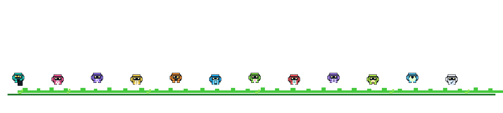
</picture>

**A professional network for the people who move sport forward.**

Athletes · Coaches · Scouts · Clubs · Sports professionals

[Open SPORTSLINK](https://sportslink.up.railway.app/) · [Issues and ideas](https://github.com/addulasaikiran-ops/SportsLink/issues) · [Verified repository audit](docs/FACTS.md)

      

</div>

## What is SPORTSLINK?

Sports careers move through people: the coach who spots potential, the scout who finds a player, the club that needs a teammate, and the athlete looking for the next opportunity. **SPORTSLINK is a sports-focused professional networking web application** built to help athletes, coaches, scouts, clubs, organizations and sports professionals create profiles, discover people, follow members, share posts, explore opportunities and communicate.

<p align="center">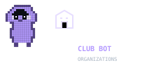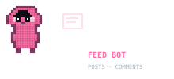</p>\n\nThe frontend is built with Next.js and Supabase. A Spring Boot API supports selected authenticated workflows. The app also includes a Nexconn chat integration and a GitHub Actions workflow that can build a connected Capacitor Android debug APK.

> **Accuracy note:** Feature descriptions below are grounded in repository code and migrations, not live usage or uptime telemetry. A route or endpoint existing does not prove every workflow is complete. See [docs/FACTS.md](docs/FACTS.md) for the source-based audit.

## Meet the mini-voxel bots

Six original pixel characters explain different parts of the project. Their art is drawn from tiny square SVG pixels, has transparent backgrounds, and includes small idle/blink motion. The art is original and does not use game-character assets. Rebuild the six bot sprites with the standard-library Python generator: [generate_assets.py](docs/assets/tools/generate_assets.py).

| Bot | Animation | What it represents |
|---|---|---|
| **Scout Bot** |  | Discover/member directory, follows and connection requests |
| **Courier Bot** |  | Nexconn chat UI, conversation/message endpoints and notification triggers |
| **Referee Bot** | 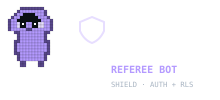 | Supabase Auth, JWT validation, and database row-level security |
| **Recruiter Bot** | 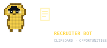 | Opportunity listing, applications and status-review endpoints |
| **Mechanic Bot** | 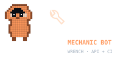 | Spring Boot API, Gradle and GitHub Actions CI |
| **Pocket Bot** | 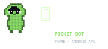 | Capacitor configuration and Android debug APK workflow |
| **Feed Bot** |  | Community posts, comments and reactions |
| **Event Bot** | 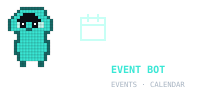 | Event data structures and event-related UI |
| **Club Bot** |  | Organizations and organization membership |
| **Bell Bot** |  | Notification endpoints and selected SQL triggers |
| **Seed Bot** | 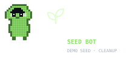 | Demo data seed and cleanup scripts/workflow |
| **Privacy Bot** | 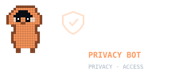 | Privacy route, access controls and security documentation |

## Features: implemented vs. roadmap

<details open>
<summary><strong>Present in the repository</strong></summary>

- **Authentication and profiles** — Supabase Auth, sign-up/login, onboarding, member profile and profile-completion flows.
- **Discover and network** — directory/discover UI, follow relationships and connection-request workflows backed by migrations and RLS.
- **Community feed** — posts, comments and reactions, with bookmarks/reposts referenced by UI/data-access code.
- **Opportunities and applications** — opportunity listing/creation plus application submission and review endpoints.
- **Messaging** — Nexconn chat UI and Spring Boot conversation/message endpoints. These are separate integration surfaces; not every frontend action is necessarily routed through Spring.
- **Notifications** — UI/data paths, Spring list/read/delete endpoints, and SQL triggers for selected post interactions and new messages.
- **Organizations and events** — workspace routes and migration-backed organization/event structures.
- **Media storage** — migration-defined policies for profile images and private post media.
- **Android packaging** — a manual GitHub Actions workflow generates a Capacitor Android project and uploads a debug APK artifact.

<p align="center"></p>

</details>

<details>
<summary><strong>Roadmap / not claimed as complete</strong></summary>

- **Signed Play Store release pipeline** — the checked-in Android workflow builds a debug APK, not a store-ready release.
- **Guaranteed offline-first/PWA experience** — Capacitor configuration exists, but a full offline-first behavior is not asserted here.
- **Every frontend workflow routed through Spring** — some features access Supabase directly, and the repository audit notes endpoints without confirmed shared-adapter callers.
- **Full automated end-to-end coverage** — broader integration coverage remains work to verify.
- **Production uptime, usage or performance metrics** — no runtime telemetry is claimed.

</details>

## Architecture

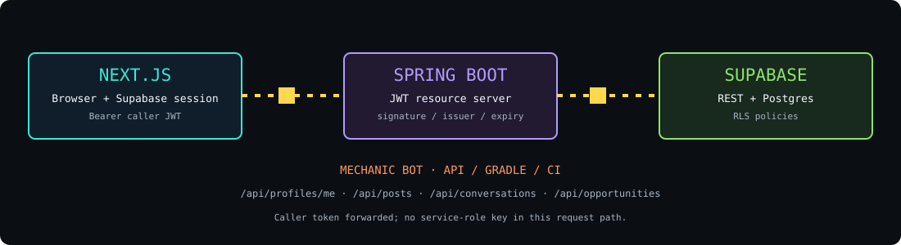

<p align="center"></p>

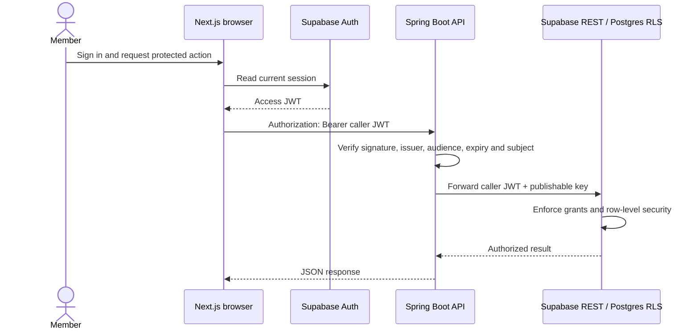

## Security model

<p align="center"></p>

- The frontend uses the Supabase **publishable key** for client configuration. The publishable key is not a substitute for access control; Auth and RLS enforce data access.
- Backend security configuration allows <code>OPTIONS</code> and <code>GET /api/health</code> without authentication. Other inspected API routes require a JWT.
- The backend verifies caller JWTs and the Supabase REST request path forwards the **caller's token** alongside the publishable key. It does not use a service-role key for that request path.
- SQL migrations include RLS policies and hardened messaging helper/RPC changes. Read the migration definitions when changing security-sensitive SQL.
- Keep <code>NEXCONN_APP_SECRET</code>, Supabase service-role credentials and other server secrets out of <code>NEXT_PUBLIC_*</code>, the browser bundle and commits.
- This documentation is not a claim of a third-party security audit.

## Spring Boot API reference

<p align="center"></p>

Derived from controller mapping annotations. Protected endpoints require a JWT unless marked public.

| Method | Endpoint | Purpose |
|---|---|---|
| GET | <code>/api/health</code> | Public health check |
| GET | <code>/api/me</code> | Current authenticated identity |
| GET, PATCH | <code>/api/profiles/me</code> | Read/update own profile |
| GET | <code>/api/profiles</code> | Profile lookup/list |
| GET, POST | <code>/api/posts</code> | List/create posts |
| GET, POST | <code>/api/posts/{postId}/comments</code> | Read/create comments |
| GET | <code>/api/posts/{postId}/reactions</code> | Read reactions |
| PUT, DELETE | <code>/api/posts/{postId}/reaction</code> | Set/remove reaction |
| GET | <code>/api/follows</code> | List follows |
| POST, DELETE | <code>/api/follows/{profileId}</code> | Follow/unfollow |
| GET | <code>/api/notifications</code> | List notifications; supports <code>?unreadOnly=true</code> |
| PATCH | <code>/api/notifications/{notificationId}/read</code> | Mark notification read |
| DELETE | <code>/api/notifications/{notificationId}</code> | Delete notification |
| GET, POST | <code>/api/opportunities</code> | List/create opportunities |
| GET | <code>/api/applications/me</code> | List own applications |
| GET, POST | <code>/api/opportunities/{opportunityId}/applications</code> | List applications/apply |
| PATCH | <code>/api/applications/{applicationId}/status</code> | Review application status |
| GET, POST | <code>/api/conversations</code> | List/create conversations |
| GET, POST | <code>/api/conversations/{conversationId}/messages</code> | List/send messages |
| PATCH | <code>/api/conversations/{conversationId}/read</code> | Mark conversation read |

## Database and migrations

<p align="center"></p>

The repository has **14 SQL migration files across two directories**; this is not a complete baseline schema for a fresh database. The migrations cover events, private post media, profile-image storage, signup/profile hardening, notification triggers, messaging RLS helpers, onboarding fields, organizations, connection requests and seed-profile support.

Tables referenced by inspected SQL and data-access code include <code>profiles</code>, <code>posts</code>, <code>post_media</code>, <code>post_reactions</code>, <code>post_bookmarks</code>, <code>post_reposts</code>, <code>comments</code>, <code>follows</code>, <code>notifications</code>, <code>conversations</code>, <code>conversation_members</code>, <code>messages</code>, <code>opportunities</code>, <code>opportunity_applications</code>, <code>events</code>, <code>organizations</code>, <code>organization_members</code> and <code>connection_requests</code>. This is a repository-derived list, not a live database catalog.

- <code>post-media</code> — private post media, with policies checking parent-post visibility and owner-folder writes.
- <code>profile-images</code> — profile images with owner-folder write policies.

Migration files live in both <code>supabase/migrations/</code> and <code>Frontend/sportslink-frontend-js/supabase/migrations/</code>. Review both before applying schema changes.

## Tech stack

| Layer | Technology |
|---|---|
| Web | Next.js 15, React 19, JavaScript / JSX |
| Identity and data | Supabase Auth, Postgres, REST and RLS |
| API | Java 25, Spring Boot 4.1.1, Gradle |
| Chat | Nexconn Chat UI/engine integration |
| UI / motion | GSAP, Lucide React |
| Mobile packaging | Capacitor Android project generation |
| CI | GitHub Actions |

## Project structure

```text
SportsLink/
├── .github/workflows/                        # Frontend/backend CI, Android APK, demo seed
├── Backend/sportslink-backend/                # Spring Boot API, JWT security, services and tests
├── Frontend/sportslink-frontend-js/
│   ├── app/                                   # Landing, auth, onboarding, profile and workspace routes
│   ├── components/                            # Feed, directory, profile, opportunity and workspace UI
│   ├── lib/supabase/                          # Browser/server Supabase clients
│   ├── lib/api/backend.js                     # Caller-JWT Spring API adapter
│   ├── scripts/seed/                          # Demo seed and cleanup scripts
│   ├── design-system/                         # UI design-system files
│   └── capacitor.config.ts                    # Connected Android shell configuration
├── supabase/migrations/                       # Core migration history
├── Frontend/sportslink-frontend-js/supabase/migrations/ # Additional migrations
└── docs/
    ├── FACTS.md                               # Repository audit and verified facts
    └── assets/                                # Original animated SVGs and generator
```

## Getting started

<p align="center"></p>

<details>
<summary><strong>Prerequisites</strong></summary>

- Node.js 22 and npm (matches frontend CI).
- Java 25 (matches the backend toolchain).
- Git and a configured Supabase project for authenticated/data-backed flows.
- Android SDK/tooling if building APKs locally; the GitHub Actions workflow provisions its build environment.
</details>

<details>
<summary><strong>1. Frontend</strong></summary>

```bash
cd Frontend/sportslink-frontend-js
cp .env.local.example .env.local
npm install
npm run dev
```

Open <code>http://localhost:3000</code>. Set your own values in <code>.env.local</code>:

- <code>NEXT_PUBLIC_SUPABASE_URL</code>
- <code>NEXT_PUBLIC_SUPABASE_PUBLISHABLE_KEY</code>
- <code>NEXT_PUBLIC_API_URL=http://localhost:8080</code>
- <code>NEXT_PUBLIC_USE_SPRING_API=false</code> (the checked-in example defaults to false)
- Nexconn values only if using that integration: <code>NEXT_PUBLIC_NEXCONN_APP_KEY</code>, server-only <code>NEXCONN_APP_SECRET</code>, and <code>NEXCONN_API_BASE_URL</code>.

Never commit real keys. Never place service-role credentials in <code>NEXT_PUBLIC_*</code>.
</details>

<details>
<summary><strong>2. Spring Boot API</strong></summary>

In another terminal:

```bash
cd Backend/sportslink-backend
./gradlew bootRun
```

The frontend example points to <code>http://localhost:8080</code>; confirm the backend's application configuration before assuming a port. Run CI-style backend checks with <code>./gradlew build</code>.

Set <code>NEXT_PUBLIC_USE_SPRING_API=true</code> to opt into the shared adapter for workflows that support it, and configure <code>NEXT_PUBLIC_API_URL</code>. This flag does not route every UI operation through Spring.
</details>

<details>
<summary><strong>3. Demo seed and cleanup</strong></summary>

```bash
cd Frontend/sportslink-frontend-js
npm run seed:demo
npm run seed:cleanup
```

Read the seed scripts' safety and confirmation requirements before running them. Depending on the operation, they may require server-only Supabase credentials and explicit write flags. Do not casually run seed commands against production. The demo-seed workflow requires manual confirmation and configured environment secrets.
</details>

<details>
<summary><strong>4. Android debug APK</strong></summary>

In GitHub, open Actions → **Build SPORTSLINK Android APK** → Run workflow. The workflow generates a Capacitor Android project and uploads the <code>sportslink-android-debug-apk</code> artifact.

This is a debug build, not a signed Play Store release. The checked-in Capacitor config points to the deployed website, so the app is currently configured as a connected web shell rather than a verified offline-first native app.
</details>

## CI/CD

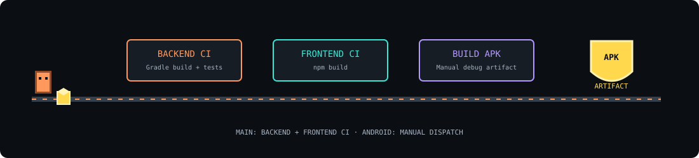

<p align="center"></p>

| Workflow | Trigger | What it does |
|---|---|---|
| <code>backend-ci.yml</code> | Push/PR to main with backend changes; manual dispatch | Sets up Java 25 and runs <code>./gradlew build</code>. |
| <code>frontend-ci.yml</code> | Push/PR to main with frontend changes; manual dispatch | Uses Node 22, validates/regenerates the npm lockfile and runs <code>npm run build</code>. |
| <code>build-android-apk.yml</code> | Manual dispatch | Generates the Capacitor Android project, builds and uploads a debug APK. |
| <code>seed-sportslink-demo.yml</code> | Manual dispatch plus exact confirmation input | Seeds labelled demo accounts/activity using environment secrets; this writes data when explicitly enabled. |

## Roadmap

- [ ] Verify end-to-end workflows with repeatable integration tests.
- [ ] Establish one canonical migration/bootstrap process across both migration directories.
- [ ] Add a signed Android release pipeline only when release operations and signing are ready.
- [ ] Verify offline/PWA behavior before advertising it as supported.
- [ ] Expand frontend and backend integration test coverage.
- [ ] Check production deployment health separately from repository source.

## Contributing

1. Search or open a [GitHub issue](https://github.com/addulasaikiran-ops/SportsLink/issues) before large changes.
2. Keep pull requests focused and explain user-visible behavior changes.
3. Run the relevant frontend build or backend tests.
4. Update docs when routes, migrations, security or environment variables change.
5. Never commit secrets, tokens, service-role credentials or real user data.

## Contact / author

Repository: [addulasaikiran-ops/SportsLink](https://github.com/addulasaikiran-ops/SportsLink)  
For bugs, questions and feature ideas, use [GitHub Issues](https://github.com/addulasaikiran-ops/SportsLink/issues).

---

<div align="center">

**Build connections. Discover potential. Move sport forward.**

<sub>Original pixel art created for this repository. No third-party character assets used.</sub>

</div>
