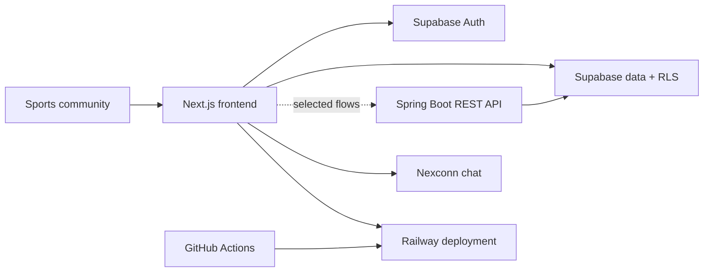
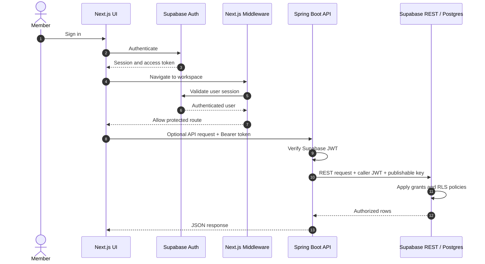

<div align="center">

<picture>
  
</picture>

<picture>
  <source media="(prefers-color-scheme: dark)" srcset="docs/assets/typing-tagline-dark.svg">
  
</picture>

<h1>SPORTSLINK</h1>
<p><strong>The professional network for people who move sport forward.</strong></p>
<p>Meet athletes, coaches, scouts, clubs and sports professionals. Build your network, share your journey, and discover opportunities.</p>

<p>
  <a href="https://sportslink.up.railway.app/"></a>
  <a href="docs/FACTS.md"></a>
  <a href="https://github.com/addulasaikiran-ops/SportsLink/issues"></a>
</p>


<p><em>Meet Pip — your tiny teammate for big sports energy.</em></p>

</div>

<div align="center">

**[Explore the platform ↓](#the-sportslink-world)** &nbsp; · &nbsp;
**[Get running locally](#run-locally)** &nbsp; · &nbsp;
**[See architecture](#architecture)** &nbsp; · &nbsp;
**[Contribute](#contributing)**

</div>

<picture></picture>


## Navigate the project

| I want to… | Best place to start |
|---|---|
| **Try the product** | [Open the live app](https://sportslink.up.railway.app/) |
| **Understand the product** | [Explore SPORTSLINK](#the-sportslink-world) · [Platform capabilities](#the-platform) |
| **Check what is actually implemented** | [Verified repository audit](docs/FACTS.md) |
| **Run the frontend** | [Frontend setup](#frontend) |
| **Explore the backend** | [API surface](#api-surface) · [Architecture](#architecture) |
| **Build the Android debug APK** | [CI and delivery](#ci-and-delivery) |
| **Help improve the project** | [Contribution guide](#contributing) |

<details>
<summary><strong>🧭 Choose your journey — open a path</strong></summary>

| If you are… | Start here |
|---|---|
| 🏃 An athlete or player | Build a profile, share updates, grow connections and explore opportunities. [Explore the platform](#the-platform) |
| 🎯 A coach, scout or sports professional | Discover profiles and build relationships across the sports community. [Project overview](#the-sportslink-world) |
| 🏟️ A club or organization | Explore organization and membership workflows, where enabled. [Verified implementation notes](docs/FACTS.md) |
| 🧑‍💻 A developer | Review the stack, system design, setup steps and known boundaries before making changes. [Architecture](#architecture) · [Run locally](#run-locally) |

</details>

<details>
<summary><strong>⚡ First five minutes for contributors</strong></summary>

1. Read the [verified project audit](docs/FACTS.md) so you know what exists today.
2. Review the [architecture](#architecture) and [project structure](#project-structure).
3. Configure the [frontend environment](#environment-variables) without committing secrets.
4. Run the frontend locally and confirm the page or workflow you plan to change.
5. Keep the change focused; run the relevant build or tests and describe the evidence in your pull request.

</details>

> **How to read this README:** Expand any disclosure to see more detail. Diagrams and mascot artwork render on GitHub without custom JavaScript. Feature descriptions are based on repository evidence; the [technical audit](docs/FACTS.md) records important implementation boundaries.

## The SPORTSLINK world

<picture></picture>

Sport is more than a game. It is people, teams, talent, relationships and opportunities.

SPORTSLINK is a professional networking platform focused on the sports community. It brings athletes, coaches, scouts, clubs and other sports professionals into one connected place to discover people, build meaningful connections, share updates and explore opportunities.

## The platform

<picture></picture>

| Capability | What it supports |
|---|---|
| **Discover your network** | Explore athlete, coach, scout and sports-professional profiles; search for people and manage connection requests. |
| **Build your profile** | Showcase sporting role, sport, headline, bio, location, education, skills and profile imagery. |
| **Share updates** | Publish posts, comment, react, bookmark useful updates and repost community content. |
| **Explore opportunities** | Find sports roles, trials, scholarships, teams, sponsorships, volunteer work and more. |
| **Stay connected** | Use member messaging, conversation threads and notifications. |
| **Connect organizations** | Create sports organizations, request membership and review member requests. |

<sub>Feature descriptions reflect repository UI/API code and migrations. Some features use direct Supabase access, the optional Spring API or Nexconn chat integration; not every feature is routed through one backend. See <a href="docs/FACTS.md">the implementation audit</a> for details.</sub>

## Feature map at a glance

| Area | Repository evidence | Important nuance |
|---|---|---|
| Member profiles and directory | UI and API paths exist | Some profile data is read directly from Supabase. |
| Feed, posts and interactions | Post, comment and reaction code exists | Not every interaction is routed through the Spring API. |
| Connections and follows | Connection-request and follow flows exist | Migration files currently live in two directories. |
| Opportunities and applications | UI/API/schema pieces exist | Some workflows may be incomplete; check the audit before assuming end-to-end readiness. |
| Messaging | Nexconn chat UI and backend conversation operations exist | Chat integration and API conversation paths are distinct parts of the architecture. |
| Organizations and events | Workspace routes and schema references exist | The presence of a route or table alone does not guarantee every workflow is production-complete. |
| Android | Manual workflow builds a debug APK | This is not a Play Store release pipeline. |

<sub>This is intentionally an evidence-oriented map, not a marketing claim that every row is fully production-ready. See <a href="docs/FACTS.md">the detailed audit</a> for source-level findings.</sub>

## Project snapshot

**189 tracked files · 29 backend API operations · 14 SQL migrations · 13 App Router page modules**  
<sub>Repository counts from the audited Git tree, not live user or production usage metrics. Evidence: <a href="docs/FACTS.md">docs/FACTS.md</a>.</sub>

## Technology stack

<picture></picture>

| Layer | Technology | Verified version / detail |
|---|---|---|
| Web framework | Next.js | 15.5.27 |
| UI | React / React DOM | 19.3.0 |
| Auth and database | Supabase JS + SSR | 2.117.1 / 0.12.7 |
| API | Spring Boot Web MVC + Security | 4.1.1 |
| Runtime | Java | Toolchain 25 |
| Build | Gradle | Wrapper 9.7.1 |
| Motion | GSAP | 3.15.0 |
| Icons | Lucide React | 0.468.0 |
| Chat integration | Nexconn | Chat 26.2.1; UI 26.2.5; Engine 26.2.1 |
| Android workflow | Capacitor | CI builds a debug APK |

## Architecture



SPORTSLINK is built around a Next.js App Router frontend. It uses Supabase Auth and data access, with a Spring Boot REST API available for selected flows. The backend validates Supabase JWTs and forwards the caller's token to Supabase REST so database grants and row-level security remain in force. The frontend also includes a Nexconn chat client and a server-side token route.

### Authentication and request flow



<sub>Some frontend screens call Supabase directly rather than traversing Spring Boot. The sequence shows the optional API path.</sub>

## API surface

The Spring Boot backend defines 29 REST operations. All require a valid Supabase access token except the public health endpoint.

<details>
<summary><strong>Explore the Spring Boot endpoints</strong></summary>

| Method | Endpoint | Auth |
|---|---|---:|
| GET | /api/health | No |
| GET | /api/me | Yes |
| GET | /api/profiles | Yes |
| GET | /api/profiles/me | Yes |
| PATCH | /api/profiles/me | Yes |
| GET | /api/posts | Yes |
| POST | /api/posts | Yes |
| GET | /api/posts/{postId}/comments | Yes |
| POST | /api/posts/{postId}/comments | Yes |
| GET | /api/posts/{postId}/reactions | Yes |
| PUT | /api/posts/{postId}/reaction | Yes |
| DELETE | /api/posts/{postId}/reaction | Yes |
| GET | /api/follows | Yes |
| POST | /api/follows/{profileId} | Yes |
| DELETE | /api/follows/{profileId} | Yes |
| GET | /api/notifications | Yes |
| PATCH | /api/notifications/{notificationId}/read | Yes |
| DELETE | /api/notifications/{notificationId} | Yes |
| GET | /api/opportunities | Yes |
| POST | /api/opportunities | Yes |
| GET | /api/applications/me | Yes |
| GET | /api/opportunities/{opportunityId}/applications | Yes |
| POST | /api/opportunities/{opportunityId}/applications | Yes |
| PATCH | /api/applications/{applicationId}/status | Yes |
| GET | /api/conversations | Yes |
| POST | /api/conversations | Yes |
| GET | /api/conversations/{conversationId}/messages | Yes |
| POST | /api/conversations/{conversationId}/messages | Yes |
| PATCH | /api/conversations/{conversationId}/read | Yes |

</details>

## Data layer

The repository contains 14 SQL migration files across two locations: the root `supabase/migrations/` directory and the frontend's `Frontend/sportslink-frontend-js/supabase/migrations/` directory.

The inspected schema and data-access code reference profiles, posts, comments, post media, reactions, follows, notifications, conversations, messages, opportunities, applications, events, organizations and connection requests.

**Connection requests are implemented and used.** The directory and public member profile components read and write `connection_requests`; it is not an unused table. The migration folders coexist and are not yet a single canonical migration root. See the [migration ledger and evidence](docs/FACTS.md#database-migrations-filename-order).

## Security

- Supabase JWT resource-server validation in Spring Security.
- Public exception limited to **GET /api/health** (OPTIONS preflight requests are also permitted).
- Configurable CORS origin allowlist; credentials are not enabled.
- Request DTO validation via Jakarta Validation.
- Spring REST proxy forwards the authenticated member's token and Supabase publishable key; it does not use a service-role key in that request path.
- Supabase RLS and Storage object policies are defined in the audited migrations.
- Next.js middleware checks the Supabase session and gates workspace routes.
- Nexconn app secret is server-only in the token route.

**Scope note:** inspected repository evidence did not establish backend rate limiting or custom CSP/security-header configuration. See [security evidence and limitations](docs/FACTS.md#security-and-request-handling).

## Run locally

### Frontend

Requirements: Node.js (CI uses Node 22).

```bash
cd Frontend/sportslink-frontend-js
cp .env.local.example .env.local
npm install
npm run dev
```

The app runs at http://localhost:3000.

### Backend

Requirements: Java 25.

```bash
cd Backend/sportslink-backend
./gradlew test
./gradlew bootRun
```

On Windows PowerShell use `./gradlew.bat test` and `./gradlew.bat bootRun`.

### Environment variables

Set only the values required by features you enable. Never commit actual secrets.

| Variable | Used by |
|---|---|
| NEXT_PUBLIC_SUPABASE_URL | Frontend Supabase clients |
| NEXT_PUBLIC_SUPABASE_PUBLISHABLE_KEY | Frontend Supabase clients |
| NEXT_PUBLIC_API_URL | Frontend Spring API adapter |
| NEXT_PUBLIC_USE_SPRING_API | Optional Spring integration switch |
| NEXT_PUBLIC_NEXCONN_APP_KEY | Nexconn app identity |
| NEXCONN_APP_SECRET | Server-side Nexconn token signing |
| NEXCONN_API_BASE_URL | Nexconn regional API |
| SUPABASE_URL | Backend Supabase REST base URL |
| SUPABASE_PUBLISHABLE_KEY | Backend Supabase REST API key |
| SUPABASE_JWT_ISSUER | Optional JWT issuer override |
| SUPABASE_JWKS_URL | Optional JWKS URL override |
| SPORTSLINK_CORS_ALLOWED_ORIGIN | Backend CORS origin allowlist |
| NEXT_PUBLIC_SITE_URL | Canonical site and auth callback origin |

The demo seed workflow also expects Actions secrets named **SUPABASE_URL** and **SUPABASE_SERVICE_ROLE_KEY**. They are used by the manual seed workflow; do not expose them to frontend/browser code.

## Project structure

```text
SportsLink/
├── .github/workflows/
├── Backend/
│   └── sportslink-backend/
│       ├── src/main/java/
│       ├── src/main/resources/
│       └── src/test/
├── Frontend/
│   └── sportslink-frontend-js/
│       ├── app/
│       ├── components/
│       ├── design-system/
│       ├── lib/
│       ├── public/
│       └── supabase/migrations/
├── supabase/migrations/
├── docs/
│   ├── FACTS.md
│   └── assets/
└── README.md
```

## CI and delivery

<picture></picture>

### Automated delivery

Four workflows are present:

- Backend CI builds and tests the Spring Boot service on Java 25.
- Frontend CI validates the npm lockfile and builds the Next.js application on Node 22.
- Android workflow builds and uploads a debug APK on manual dispatch.
- Demo seed workflow is manual, environment-gated and requires an explicit confirmation input.

The Android workflow proves a debug APK artifact path, not a Play Store release pipeline.

## Current engineering boundaries

These are repository findings, not promises or claims that a capability is complete:

- The Spring API integration switch is off by default in the sample frontend environment; callers use direct Supabase for several operations unless enabled.
- There is no frontend test/spec suite in the tracked tree; frontend CI performs a production build.
- Backend tests mock the Supabase REST client; no live-database integration test is shown in the tracked test source.
- Root and frontend migration folders coexist and include overlapping connection-request schema creation; migration history should be consolidated deliberately before new environments depend on one migration command.
- Rate limiting and custom backend security-header/CSP configuration were not found in the inspected files.
- Some frontend pages still present empty/unavailable workspaces while API operations or schema structures exist.

For exact evidence and per-feature wiring status, use [docs/FACTS.md](docs/FACTS.md).


## Questions people ask

<details>
<summary><strong>Is SPORTSLINK live?</strong></summary>

The project has a deployed app at [sportslink.up.railway.app](https://sportslink.up.railway.app/). Availability and individual feature readiness can change; the repository audit describes code evidence, not live uptime or usage telemetry.
</details>

<details>
<summary><strong>Are all listed capabilities complete?</strong></summary>

No assumption should be made from a screen, route, table or API endpoint alone. Some frontend flows use direct Supabase access, and some workflows are incomplete. Use the [verified repository audit](docs/FACTS.md) for the most accurate boundaries.
</details>

<details>
<summary><strong>How can I report a bug or propose a feature?</strong></summary>

Open a [GitHub issue](https://github.com/addulasaikiran-ops/SportsLink/issues). Include the page, steps to reproduce, expected versus actual behavior, and screenshots or logs when appropriate. Never include passwords, tokens, or personal data.
</details>

## Contributing

Contributions are welcome. Before opening a pull request:

1. Read the relevant implementation and [technical audit](docs/FACTS.md).
2. Keep changes focused and explain the user problem they solve.
3. Run the applicable checks: frontend production build and/or backend tests.
4. Never commit secrets, production data, or real user information.
5. Update documentation when behavior, setup, or known limitations change.

Open a pull request against `main` with a clear summary, test evidence, and screenshots for UI changes.

<picture></picture>

<div align="center">

<sub>The Moog Bots are decorative SVG animations, not a live CI or product-activity dashboard.</sub>

**Built for the people who move sport forward.**

<a href="https://sportslink.up.railway.app/">LIVE APPLICATION</a>
&nbsp;·&nbsp;
<a href="https://github.com/addulasaikiran-ops/SportsLink">GITHUB REPOSITORY</a>
&nbsp;·&nbsp;
<a href="docs/FACTS.md">TECHNICAL AUDIT</a>

</div>
